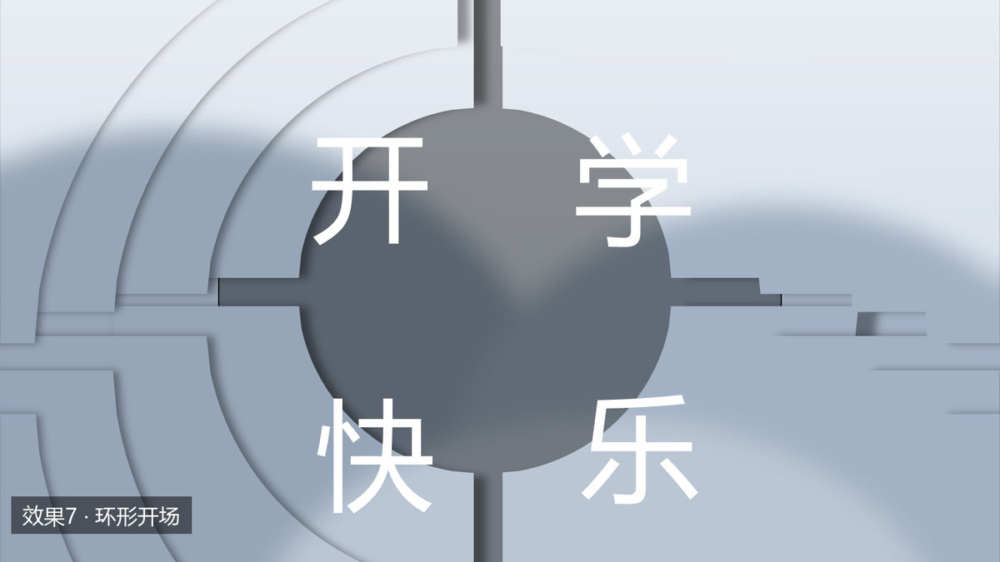

# ppt-effects · PPT 动效配方库

> **Skill 名 `ppt-effects`｜中文名「PPT 动效配方库」｜为 DeepSeek Harness 编写，也可脱离 DSH 手动使用**

> 把「调好的 PPT 动画效果」存成可复用的模块：一份 `recipe.md`（人读的意图与坑）+ 一份 `spec.json`（机器读的精确参数）+ 一份 `reference/*.pptx`（可直接打开、按配方套用）。
> 给一张图、一段文案，按配方就能出同款动效——不用从零调时间轴。



## 三步开始

```bash
# 1) 装依赖
pip install python-pptx Pillow lxml

# 2) 看有哪些效果（含每个效果的素材要求）
python tools/check_materials.py --list

# 3) 校验你的素材，再按 recipe 出稿
python tools/check_materials.py 效果6 你的图.jpg
```

然后在会话里说「用效果6 做一份，素材是这张图」即可；或直接读 `effects/006_加载指针/recipe.md` 手动做。

## 10 个效果

| 代号 | 名称 | 页数 | 素材 | 一句话 |
|---|---|---|---|---|
| 1 | 湖景斜切滑入 | 2 | 1 张 4:3，不能太暗 | 标题自左、斜切彩带自右滑入 |
| 2 | 玻璃碎片散开 | 3 / 19 | 1–5 张 | 四块玻璃叠起→散开→排成一行 |
| 3 | 哲学字动 | 图数×2+2 | 1–5 张（荐 4–5） | 巨型字母位移 + 照片穿插，自动换片 |
| 4 | 扇形展开 | 2 | 1 张 ≈1.77 | 12 片扇形收拢后 2 秒展开 |
| 5 | 三段上滚 | 3 | 1 张 | 正文随翻页上滚，配大号章节号 |
| 6 | 加载指针 | 1 | 1 张深色图 | 七段变速旋转指针 + 标题淡入 |
| 7 | 环形开场 | 25 | 1 张（13 个槽） | 48 片刀片扫光 → 圆形取景 → 四字散排 |
| 8 | 纯矢量动画 | 33 | 不用图 | 纯版式：封面/目录/四章/时间轴 |
| 9 | 金边弧线 | 19 | 16 个槽（可重复） | 深蓝弧线 + 圆形取景 + 超大数字 |
| 10 | 暗红塔影 | 11 | 白底图或透明 PNG | 深红底 + 金色线稿 + 光束 |

每个效果的预览图在 `docs/preview/`（均以中性素材渲染，可直接用于介绍）。

## 目录结构

```
index.md                效果目录：代号 → 目录 → 素材要求 → 动画要点
SKILL.md                作为 Agent Skill 使用时的入口（可让 AI 直接读）
docs/USER-GUIDE.md      用户使用说明（选效果 → 校验 → 出稿）
docs/MAINTENANCE.md     修改与更新说明（给维护者）
docs/INSTALL.md         装到另一台机器 / 另一个 Harness
docs/preview/           10 张预览图
effects/NNN_xxx/
    recipe.md           人读：结构、参数、坑、复用管线
    spec.json           机器读：几何/字体/切换/素材约束
    reference/*.pptx    参考件：可打开、可当模板套
    svg/                仅 001、002：可直接走 SVG 管线
tools/
    check_materials.py  素材校验（数量/画幅/明暗/白底/透明）
    patch_effect*.py    导出后精确校正
```

## 素材规则（检查器会拦）

- **数量与画幅**：槽位画幅写在 `spec.json` 的 `materials.aspects`；超差按 `crop_allowed` 决定“裁切”还是“拒绝”。
- **明暗**：黑字效果（效果1）要亮图，亮度 <140 会警告；深色效果（效果6）要暗图。
- **白底/透明**：效果10 只认白底图或已抠好的透明 PNG，其它一律阻断。
- **重复用图**：效果9 只有 4 张也能铺 16 槽，不会混入参考件的旧图。

## 环境

- Python 3.10+，`python-pptx`、`Pillow`、`lxml`
- PowerPoint 2019+（morph 切换是 `p159` 枚举；旧版会降级成淡入淡出）
- 效果 1/2短 的 SVG→PPTX 管线需要 [ppt-master]；其余 8 个效果不需要
- 参考件里的 `<LIB_ROOT>` / `<USER_HOME>` / `<ABS_PATH>` 是路径占位符，按本机情况改

## 字体

参考件**不含嵌入字体**，字体名已统一为开源字体，本机未装时自动回退、版式仍成立：

| 用途 | 字体 |
|---|---|
| 手写 / 楷体 | 霞鹜文楷 LXGW WenKai |
| 黑体标题 | 思源黑体 Source Han Sans / MiSans |
| 宋体正文 | 思源宋体 Source Han Serif / Noto Serif SC |
| 系统感 | HarmonyOS Sans SC / Noto Sans SC |
| 西文衬线 | EB Garamond / Liberation Serif |

## 素材与来源

- 参考件照片为作者自有素材（湖 / 草原 / 盘山 / 开学），按槽位裁切；
- 效果3 原稿的内嵌配乐已移除（来源不明且自动播放）；
- 预览图用中性色块渲染，不含第三方图片；
- **效果8 的版式源自第三方模板**（作者信息已移除、文字已替换为占位文字、配色已重做），版式相似性由使用者自行评估；
- 其它第三方素材（他人模板、网络图片、嵌入字体、音视频）已全部移除。

## 依赖与致谢

- **ppt-master**（MIT，© 2025-2026 Hugo He）：效果 1、2 短版的 SVG→PPTX 管线依赖它——`project_manager.py`、`svg_to_pptx.py`、`svg_quality_checker.py` 均来自该技能。本仓库**不包含**其代码，仅调用；装法见各自的 `recipe.md`。
- **DeepSeek Harness**：本库以 Skill 形式编写，入口是 `SKILL.md`（frontmatter 的 `name: ppt-effects`）。在 DSH 里直接说「用效果6 做一份」即可；不装 DSH 也能用——按 `docs/USER-GUIDE.md` 手动跑命令、或直接改 `reference/*.pptx`。
- 字体与图片的授权边界见下一节。

## 许可

- 代码（`tools/`）与文档：MIT + CC BY 4.0（见 `LICENSE`）
- 字体不在本库授权范围内，商用请自行确认字库许可
- 照片版权归作者；若含可识别人物，公开传播前请自行确认肖像权

更多细节：[使用说明](docs/USER-GUIDE.md)｜[维护说明](docs/MAINTENANCE.md)｜[安装](docs/INSTALL.md)
