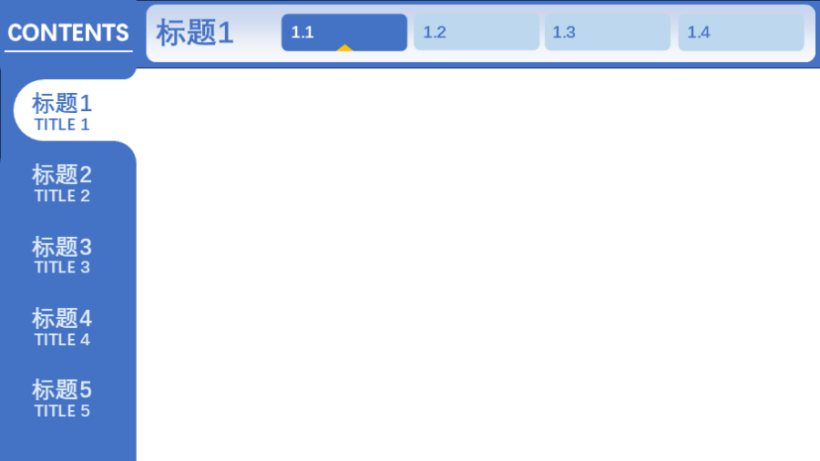

# 效果17 · 纵横导航栏

**基准件**：`reference/效果17.pptx`（20 页，140 KB）
**方式**：`template-clone` —— **只改文字、字体、字号、配色，不动形状与版式**



## 一、它是什么

一套"双轴导航"版式：**顶栏管子页，左栏管章节**。

```
┌──────────────────────────────────────────────────────┐
│ CONTENTS  标题1      [1.1]  1.2   1.3   1.4          │  ← 顶栏
├───────┬──────────────────────────────────────────────┤
│ 标题1 │                                              │
│TITLE 1│                                              │
│──────────────────────────────────────────────────────│
│ 标题2 │              内 容 区                        │
│TITLE 2│                                              │
│ 标题3 │                                              │
│ 标题4 │                                              │
│ 标题5 │                                              │
└───────┴──────────────────────────────────────────────┘
```

- **5 个章节**（左栏竖排，中文 + 英文）
- **每章 4 个子页**（顶栏 1.1–1.4）
- **20 页 = 5 × 4**，第 i 节第 j 子页 = 第 (i−1)×4+j 页
- 每页只有**当前章节项**和**当前子页标签**变成浅蓝胶囊，其余为白字

## 二、允许改什么

| 项 | 说明 |
|---|---|
| **文案** | 5 个章节中文名、5 个英文名、顶栏章节名、20 个子页标签 |
| **字体** | 整个导航栏统一换字体（中文/英文各一种） |
| **字号** | 章节名、英文名、子页标签可分别调，但要保证不换行 |
| **配色** | 主蓝 `#4472C4`、浅蓝 `#DEEBF7`、淡蓝 `#BDD7EE`、金色 `#FFC000` 可整套替换 |

## 三、不能改什么

| 项 | 原因 |
|---|---|
| 形状几何与位置 | 高亮胶囊与文字是**对齐关系**，一动就错位 |
| 页数结构 | 5×4 是几何决定的；加减章节要重排版式，不属于本效果 |
| 高亮逻辑 | 第 i 节高亮第 i 项、第 j 子页高亮第 j 标签，由页序决定 |

## 四、换文案的操作

```
1. 复制 reference/效果17.pptx
2. 左栏：第 i 页的「标题i / TITLE i」两处一起改（20 页都要同步）
3. 顶栏：改当前章节名（同一节 4 页一致）
4. 子页：改 1.1–1.4 为目标子页名（同一子页 5 页一致）
5. 配色：按主色 → 浅色 → 淡色 → 白色 四档整体替换
```

**一致性铁律**：同一章节名在 20 页里出现的位置不同但**必须字字相同**；同一子页名在 5 页里必须相同。改漏一页，翻页时就会"闪一下"。

## 五、字数上限（按现有框宽）

| 位置 | 框宽 | 建议字数 |
|---|---|---|
| 左栏中文名 | 129px | ≤ 5 字 |
| 左栏英文名 | 165px | ≤ 12 字符 |
| 顶栏章节名 | 191px | ≤ 7 字 |
| 子页标签 | 168px | ≤ 5 字 |

超限会换行，直接压到下一行的高亮胶囊上。

## 六、配色建议

| 场景 | 主色 | 浅色 | 强调 |
|---|---|---|---|
| 学术/答辩（默认） | `#4472C4` | `#DEEBF7` | `#FFC000` |
| 暗红学术 | `#90201E` | `#F2E4E2` | `#C3AE53` |
| 墨绿沉稳 | `#29465B` | `#E3E8EC` | `#C3AE53` |
| 灰阶极简 | `#333333` | `#EDEDED` | `#B08968` |

---

## 七、可改项与默认值（**调用时由用户决定**）

基准件本身保持原样，下列只是"哪些地方可以换"，不等同于已经改过：

| 可改项 | 原稿默认值 | 用户可改成 |
|---|---|---|
| 章节名（中） | 标题1–5，28pt | 任意 ≤5 字，字号 18–32pt |
| 章节名（英） | TITLE 1–5，20pt | 任意 ≤12 字符，字号 11–20pt |
| 顶栏章节名 | 标题1，36pt | 与左栏同名，字号 20–32pt |
| 子页标签 | 1.1–1.4，20pt | 任意 ≤5 字，字号 13–20pt |
| 字体 | 等线 | 任意中文字体（中英同族或分设） |
| 配色 | 主 `#4472C4` / 浅 `#DEEBF7` / 淡 `#BDD7EE` / 金 `#FFC000` | 整套替换，四档一起换 |

**字号改小时的连带处理**：字号一缩，原来的基线会让文字贴到高亮胶囊上沿，需要按键位微调（章节 +7、英文 +3、顶栏 +9、子页 +6、CONTENTS +5 为经验值）。这属于"改文字"的配套动作，不算改几何。

## 八、已知限制

1. 字号再小（章节 <18pt）时，左栏 5 行会显得空，建议同步缩小行距——但行距属于几何，**本效果不允许改**，所以最小建议 18pt；
2. 章节名超过 5 字会换行，压住下一行；英文超过 12 字符同理；
3. 配色改动要**四档一起换**（主/浅/淡/白），只换主色会出现"高亮块与文字同色"的糊掉。

## 九、定稿（2026-11-13）

**无图板定稿**：<USER_HOME>\<OUTPUT_DIR>\效果17-纵横导航栏-无图板.pptx

- 20 页，导航完整，内容区留空
- 20 页全部 **平滑切换 1.5s**（p159:morph option=byObject）
- 用法：拷这一份，往内容区放图片和正文即可

**加强方式**：
1. 图片先用 image-tools/ 处理成形状遮罩（切角/六边/拱形…），再放进内容区
2. 正文文本框按内容区宽度排版，避免压到左栏
3. 保持每页结构一致，平滑切换才对得上（同一元素跨页尽量同名同位）

> 注意：用 COM 设置 SlideShowTransition.EntryEffect 写不出 morph（会退化成普通切换），
> 必须直接写 <p:transition><p159:morph option=byObject/></p:transition>。

## 十、手写 morph 的规范（2026-11-14 修复记录）

**症状**：文件打开时 PowerPoint 提示需要修复。

**原因**：<p159:morph> 写了但没声明命名空间，或者命名空间写错。

**正确写法（三要素缺一不可）**：

`xml
<mc:AlternateContent xmlns:mc=http://schemas.openxmlformats.org/markup-compatibility/2006>
  <mc:Choice xmlns:p159=http://schemas.microsoft.com/office/powerpoint/2015/09/main Requires=p159>
    <p:transition spd=slow p14:dur=1500
                  xmlns:p14=http://schemas.microsoft.com/office/powerpoint/2010/main>
      <p159:morph option=byObject/>
    </p:transition>
  </mc:Choice>
  <mc:Fallback>
    <p:transition spd=slow><p:fade/></p:transition>
  </mc:Fallback>
</mc:AlternateContent>
`

1. **p159 命名空间是 2015/09/main**——写成 2010/main 时 PowerPoint 不报错，但会**静默丢掉 morph**
2. 必须用 mc:AlternateContent 包裹，Requires=p159
3. 裸写 <p159:morph> 而不声明 → **提示需要修复**

**验证方法（必做）**：

`
1. PowerPoint COM 打开 → 另存副本
2. 检查副本里每页是否仍含 morph
3. COM 读 SlideShowTransition.EntryEffect，应为 3954（morph）
只看 LibreOffice 渲染通过不算数——它宽容，PowerPoint 严格。
`

## 十一、偏学术风版（2026-11-14）

**参考件**：
eference/效果17-偏学术风版.pptx（20 页 = 5 章 × 4 子页）
**与经典版的关系**：版式骨架相同（顶栏管子页、左栏管章节），视觉与实现完全另做。

### 三层结构（关键）

`
第 1 层  bg.png      页面底 + 内容白板
第 2 层  bar.png     顶栏（四页完全相同的图）
         rail.png    左栏底板（四页完全相同的图）
第 3 层  hole_*.png  镂空块（同素材，位置/高度随页变化）
第 4 层  slider_*.png 渐变滑块（同素材，位置/高度随页变化）
第 5 层  文字
`

**铁律：底图必须四页完全相同。**
镂空如果直接挖在顶栏/左栏的图里，每页就是不同的 PNG，morph 会整条交叉淡化 → 导航整条闪烁。把洞和滑块拆成独立素材后，morph 只平移/缩放这两个小图，底图不动。

### 左栏几何（让位规则）

| 项 | 值 |
|---|---|
| 激活项高度 | 140 |
| 其余项高度 | 66 |
| 普通间隙 | 40 |
| 激活项两侧间隙 | 54 |

激活项拉长时，其余项缩短并整体移位让出空间，整组在底板内垂直居中。

### 文字

- 大标题：大标题，28pt 加粗白字
- 顶栏：标题1–4，18pt，居中
- 左栏：标题1–5，14pt，逐字竖排（每字一个文本框）

### 排版坑

1. 顶栏标签会折行 → 导出后设 odyPr wrap=none，居中的标签还要**加宽并左移半宽**保持居中
2. 逐字竖排的文字在 morph 下会有轻微重影 → 用 p159:morph option=byChar，比 yObject 稳
3. 左栏底板要留内边距，否则最后一个洞的描边贴底

### 与经典版的差异

| 项 | 经典版 | 偏学术风版 |
|---|---|---|
| 高亮方式 | 浅蓝胶囊背景 | 镂空 + 渐变滑块 |
| 填充 | 纯色为主 | 多处渐变 + 斜向高光 + 金线 |
| 动效 | morph（对象） | morph（byChar）+ 滑块位移/高度过渡 |

## 十二、调用规则（2026-11-14 更新）

### 必须先问

1. **用哪个版本**：经典版（胶囊高亮）还是偏学术风版（渐变 + 镂空 + 滑块）
2. **章节数 / 每章子页数**——不写死 5×4，由用户文案决定
3. 各章节名、各子页名、大标题
4. 字体字号（默认 Microsoft YaHei：大标题 28 / 顶栏 18 / 左栏 14）

### 导航数量由文案推导

| 导航 | 数量来源 |
|---|---|
| 左栏（竖向） | **章节数**，自上而下 |
| 顶栏（横向） | **每章子页数**，自左向右 |
| 页数 | 章节数 × 子页数 |

例：4 章 × 3 子页 = 12 页；6 章 × 2 子页 = 12 页。

### 疏密自适应（偏学术风版）

| 项 | 规则 |
|---|---|
| 普通项高度 | 56–96，项少则高、项多则矮 |
| 激活项高度 | 固定 140（能容 6 字以上） |
| 普通间隙 | 12–64，由剩余空间推导 |
| 激活两侧间隙 | 普通间隙 × 1.35 |
| 兜底 | 总高超出底板时自动收缩（拟合循环） |

实测：5×4 → 项高 96 / 间隙 22；4×3 → 项高 96 / 间隙 62；6×2 → 项高 58 / 间隙 36。

### 生成器

```
python tools/build_academic.py \
  --chapters "标题1;标题2;标题3;标题4" \
  --subs "标题1;标题2;标题3" \
  --title 大标题 \
  --out 效果17-偏学术风版.pptx
```

脚本自动完成：几何计算 → SVG → pptx → 注入 morph(byChar) → 关闭换行。

## 十三、疏密原则（2026-11-14 定稿）

### 三条硬规则

1. **间隙一致**：无论顶部还是左侧，镂空与镂空之间的距离必须相等
2. **分布均匀**：项少时**拉大项高**，不要拉大间隙
3. **整体定位**：
   - 左侧：**垂直居中**
   - 顶部：**右对齐**（末项右边距 32px）

### 顶部（横向）

| 项 | 规则 |
|---|---|
| 普通标签宽度 | 96–150 自适应 |
| 激活标签 | 普通 × **1.45**（项多时靠“拉长当前、缩短其他”腾空间） |
| 间隙 | 10–12，全部相等 |
| 对齐 | 右对齐；标签随激活项变化时整体仍靠右 |

### 左侧（纵向）

| 项 | 规则 |
|---|---|
| 激活项高度 | 140 |
| 普通项高度 | 56–120 自适应 |
| 间隙 | 12–64，**全部相等**（激活两侧不再放大） |
| 对齐 | 整组垂直居中 |

### 数量推导

项数由文案决定：左栏 = 章节数，顶栏 = 每章子页数，页数 = 两者相乘。

### 用户定制

用户对导航的分布有额外要求（例如某项特别长、某些项合并、顶部靠左等），**按用户要求调整**，不要硬套默认规则。

### 实测

| 配置 | 页数 | 左栏项高/间隙 | 顶部标签宽/间隙 |
|---|---|---|---|
| 5×4 | 20 | 96 / 22 | 150 / 12（激活 217） |
| 4×3 | 12 | 96 / 62 | 150 / 12（激活 217） |
| 6×2 | 12 | 56 / 38 | 150 / 12（激活 217） |

## 十四、正文与边框规则（2026-11-14）

### 正文字号：按内容量自适应

| 内容量 | 字号 | 行距 |
|---|---|---|
| ≤3 条、每条 ≤14 字 | 26 | 50 |
| ≤4 条、每条 ≤18 字 | 23 | 46 |
| ≤5 条、每条 ≤22 字 | 20 | 42 |
| 更多 | 18 | 38 |

### 对齐

- 水平：标题、金色短线、要点全部**居中**
- 垂直：按内容块总高（标题 + 线 + n×行距）反算起始 y，使整块在内容区**垂直居中**

### 图片边框：不许重复堆砌

**同一种边框在同一份 PPT 里单独使用最多 2 次**（用户明确要求除外）。

不足时靠**组合边框**扩充：

| 组合 | 构成 |
|---|---|
| `arch_bar` | 拱形 + 底部横条 |
| `cut_notch` | 切角 + 右下缺口矩形 |
| `circle_2` | 大圆 + 右上小圆 |
| `hex_bar` | 六边 + 左侧竖条 |
| `cut_dbl` | 切角 + 内框细线 |

实现：`combo_mask(spec)` 把多个形状画进同一张 L 遮罩取**并集**，
图像按并集裁切，描边用「遮罩 − 腐蚀」得到边界并烘进 PNG。
这样“框”与“图”同源，**永远不会出格、也不会在形状内留白**。

### 坑

1. 用 SVG 叠描边画拱形时，弧长参数算错会画到形状外（表现为“框出格 + 图上方留白”）
2. 20 页只用 2 种边框会显得偷懒；按上面的组合库轮换，每种 ≤2 次

### 正文底卡与字号拟合（2026-11-14 追加）

- 正文块加**底卡片**：圆角矩形（#F6FAFF 填充 + #DCE8F6 描边）+ 左侧 6px 金色竖条，
  卡片随内容块高度自适应（上下各 34px 内边距），整块水平/垂直居中
- 字号不再按“条数”硬编码，改为**按列宽拟合**：
  字号 ≤ 可用宽度 / 最长行的 em 宽度（中文 1em、西文 0.55em），再与基准号取小
- 双线边框：rch_inset / cut_inset / hex_inset = 外框 + 内缩 12px 的细线，观感更稳

### 坑（新增）

5. **导出失败但无报错**：目标 pptx 正被 PowerPoint 打开时，导出会在最后一步失败。
   先关 PowerPoint 再生成。
6. 长行会换行：必须按 em 宽度拟合字号，不能只按条数判断。

### 正文字号下限（2026-11-14 追加）

**正文一律 ≥20pt**，低于 20pt 视为不合格。为保证装得下：

- 图片显示宽度收到 330px（帧素材仍 440×292，等比缩放）
- 网格卡格子高度 150，格内 20pt，超长自动折两行
- 时间轴：日期在竖线左侧（17pt），胶囊内事项 20pt
- 数据块：数字 40–56pt，标签 18pt

### 引文卡使用前提

- **不单独使用**：同页必须有引文以外的内容（≥2 条要点胶囊）
- 卡片尺寸收敛（宽 ≤560，高 ≈150），引文字号 18pt 可比正文小

### 时间轴

- 日期放线外（左侧），不要塞进胶囊
- 竖向/横向、直线/曲线都可，按版面选

### 垂直居中基准（2026-11-14 追加）

内容块（网格卡 / 时间轴 / 引文卡+要点 / 数据块）一律以**内容区中心**为基准居中，
不要以“小标题标签下方剩余空间”为基准——后者会让整块偏低 50–60px。

实现：cyc = (cy0 + cy1) // 2，y = max(body_top, cyc - 块高/2)。

## 十六、可编辑化改造（2026-11-14 实战结论）

### 1. 取景图：形状 + 图片填充（不再烤 PNG）

```xml
<p:sp>
  <p:spPr>
    <a:xfrm>…</a:xfrm>
    <a:prstGeom prst="snip2SameRect">…</a:prstGeom>   <!-- 或 round2SameRect / ellipse -->
    <a:blipFill><a:blip r:embed="rIdX"/><a:stretch><a:fillRect/></a:stretch></a:blipFill>
    <a:ln w="28575"><a:solidFill><a:srgbClr val="C3AE53"/></a:solidFill></a:ln>
  </p:spPr>
</p:sp>
```

- 切角 `snip2SameRect`（adj1≈12000）、拱形 `round2SameRect`（adj1≈40000）、圆 `ellipse`
- **圆和形状一律优先预设几何**；要并集/剪除/自由轮廓再上 `custGeom`

### 2. custGeom 三条硬要求（血泪教训）

| # | 要求 | 不满足的后果 |
|---|---|---|
| 1 | `<a:path fill="norm">` | 有轮廓、**无填充**（图看不见） |
| 2 | `spPr` 顺序 `xfrm → geom → 填充 → ln` | **PowerPoint 提示"需要修复"** |
| 3 | 路径首尾闭合、坐标 ∈ [0,100000] | 修复提示 / 渲染错乱 |

校验脚本：`image-tools/tools/custgeom_check.py`

实测：P12 双圆并集第一次漏 `fill="norm"`（圆里没图）；第二次把 `blipFill` 写在 `ln` 之后（报修复）；补齐后一次通过。

### 3. 图片填充的两个坑

1. **必须注入独立媒体**：不能从页面现有 rels 里"猜"图，否则容易指到背景图
2. **必须显式建 rels**：`rIdPX → ../media/xxx.jpg`，并确认 `[Content_Types].xml` 有 jpg 声明

### 4. 文字底卡填图：必须配局部蒙版

- 蒙版尺寸 = 卡片尺寸（略小 2–3px），**只覆盖卡内，不得外溢**
- 背景亮 → 白色蒙版（当前 45% 不透明）+ 深色字
- 背景暗 → 深色蒙版 + 白色字
- 蒙版是独立形状，透明度可在 PPT 里直接改

### 5. 五页特殊版式参数（1280×720）

| 页 | 结构 |
|---|---|
| P4 时间轴 | 竖线 3×306 @x=470；4 圆点 ⌀14；4 胶囊 430×40；日期右对齐在线左 180px；行距 92 |
| P7 强调卡 | 卡 338×208 + 蒙版 335×206 + 标题 15pt + 副题 13pt + 金线 52×3；双胶囊 330×52；重点标签 96×54 |
| P11 引文卡 | 引文卡 470×132（17pt）+ 2 张正文卡 700×110（18pt）+ 序号块 34×34 |
| P12 双卡双圆 | 2 bar 卡 620×120（金条 6×92）；双圆并集 356×304；说明板 300×86（55% 深色）|
| P20 数据块 | 3 卡 210×140 + 数字 30pt + 标签 15pt；合计条 678×74，22pt |

### 6. 分层约定（本套风格）

```
导航（背景/顶栏/左栏/按钮/滑块/标签）→ 保持图片版观感（PNG）
底卡 / 序号块 / 取景图 / 蒙版      → 原生形状（可编辑）
```

### 7. 尺寸不是定值（2026-11-14 追加）

文中所有坐标/尺寸（双圆 420×390、说明板 382×110、卡 620×120 等）都是**当前稿的取值**，不是规范。

排版时按三件事推：
1. 文案字数（先决定要不要折行）
2. 字号下限 ≥20pt
3. 剩余可用区域

同一版式在不同页可以有不同尺寸；P9 与 P12 都是「双卡 + 圆」但尺寸不同，就是实例。

### 8. 分区说明

本效果属**动效类**；其偏学术风分支已迁入 effects/academic/学术导航0/。
调用任一方时要提示另一方存在（同骨架双风格）。
