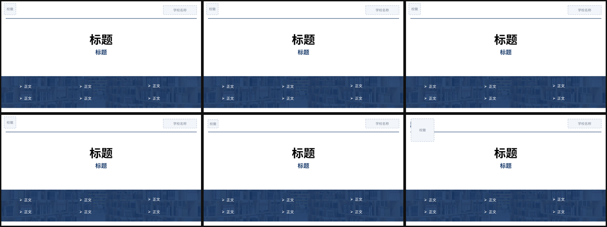

# 学术蓝 · 六套导航版式（可编辑模板）

> 来源：`901开题答辩组会文献PPT模板\1 学术蓝PPT模板` 的 6 个「导航栏」版式。
> 每份已**删除前 3 页**，其余 23 页全部保留原版式，只做占位化。



## 一、文件

| 模板 | 页数 | 说明 |
|---|---|---|
| `reference/学术蓝-导航栏1-可编辑模板.pptx` | 23 | 版式 1（书架底图 + 顶部导航） |
| …导航栏2…6 | 23 | 其余五种导航版式 |

预览：`preview/导航栏N_p01.png`（封面）、`导航栏N_p07.png`（内容页）

## 二、占位规则

| 对象 | 变成 |
|---|---|
| 文字 ≥26pt，以及顶部导航栏标签 | **标题** |
| 其余文字 | **正文** |
| 内容图片（宽 <1100） | 虚线框 + **图片** |
| 铺满整幅的背景/装饰图（宽 ≥1100） | **保留原样** |
| 表格 | 虚线框 + **表格** |
| 页面顶部区（y<210）的校徽 | 虚线框 + **校徽** |
| 含「大学/学院/学校」的短文字 | **学校名称** |
| 表单字段：指导教师 / 导师 / 答辩人 / 日期 / 课题小组 / 研究方向 / 专业 / 姓名 / 学号 / 院系 / 电话 / 邮箱 | **保留标签，值改 xxx**（如「研究方向：xxx」） |

所有对象仍是 **PowerPoint 原生形状/文本框**，未烘焙成图片。

## 三、调用流程（重要）

1. 用户选定版式（导航栏 1–6）
2. **提示用户可提供**：
   - 校徽图片 → 替换「校徽」占位框（位置/大小与原版一致）
   - 学校名称文字 → 替换「学校名称」占位框
   - 内容图片 → 填入对应的「图片」占位框
   - 表格 → 填入「表格」占位框
3. 提供了就替换并**删除占位文本框**；没提供则保留占位
4. 文字按「标题/正文」逐块确认内容（四要素规则同样适用于字号/字体）

## 四、配色

默认 **学术蓝**（`palette-tools`），与学术导航0 同一套标准色。
若要红/绿/紫，见 `palette-tools/tools/recolor.py`。

## 五、重新生成

```bash
python template-tools/tools/scrub_template.py \
  "源.pptx" "输出.pptx" 4 "学术蓝-导航栏1"
```

第 3 个参数 = 从第几页开始保留（4 = 删前 3 页）；
第 4 个参数 = `template-tools/logo_boxes.json` 里的坐标表键名。
