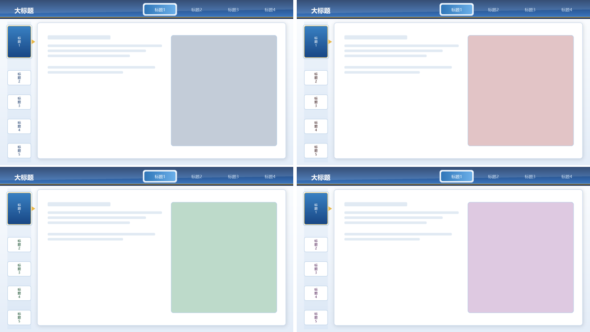

# 学术导航0 · 纵横导航栏（偏学术风版）

- 类别：**偏学术类**
- 来源：动效类「效果17 纵横导航栏」的偏学术风格分支
- 页数：20（5 章 × 4 子页）
- 参考件：`reference/学术导航0-纵横导航栏-偏学术.pptx`（占位骨架，正文为灰色占位条）
- 实填示例：`samples/2026-11-15-学术导航0-实填示例-学术蓝.pptx`（只作内容示意，**不是参考件**）



## 四套配色（同一结构，只换色值）

| 配色 | 主色 | 参考件 | 预览 |
|---|---|---|---|
| 学术蓝 | `183A6A` | `reference/…-偏学术.pptx`（占位） | `preview/学术蓝_p01.png` |
| 学术红 | `911D22` | 按需生成 | `preview/学术红_p01.png` |
| 学术绿 | `016F35` | 按需生成 | `preview/学术绿_p01.png` |
| 学术紫 | `80308B` | 按需生成 | `preview/学术紫_p01.png` |

生成任意配色：

```bash
python palette-tools/tools/recolor.py 学术红
python palette-tools/tools/recolor.py 紫  out/学术导航0-紫.pptx
```

脚本只做**颜色替换**（不结构改动），映射表见 `recolor.py` 的 `mapping()`：

```
深蓝底 17335F → palette.dark
滑块/激活 2F76B8 → palette.primary
顶栏渐变 3E7CC8 → tint(primary, 0.35)
非激活标签 2A5E9E → shade(primary, 0.12)
胶囊底 EAF1FA → tint(primary, 0.90)
卡片描边 DCE8F6 → tint(primary, 0.74)
金色 C3AE53 → palette.accent（FFC000）
```

## 调用前置

1. **先问风格**：动效 / 偏学术
2. **偏学术再问选色**：学术蓝 / 红 / 绿 / 紫（未答复不得出稿）
3. 再问四要素（文本框数量 / 内容 / 字体 / 字号）

## 与动效类的关系

| | 效果17（动效类） | 学术导航0（偏学术类） |
|---|---|---|
| 版式骨架 | 同 | 同 |
| 视觉 | 深蓝渐变、胶囊高亮 | 学术配色体系、图片填充卡 |
| 可编辑 | 部分历史版本为 PNG | 底卡/取景图/蒙版全部原生 |

互链规则：点效果17 提示「另有偏学术类学术导航0」；点学术导航0 提示「动效向可选效果17」。
