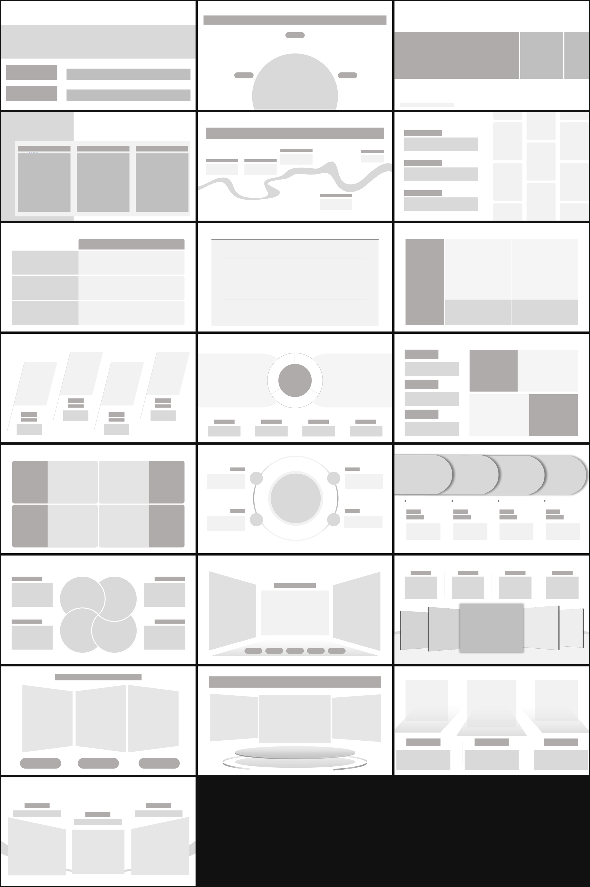

# layout-tools · 版式区

> 偏学术/汇报用的**版式骨架库**。参考件是原生形状构成的可编辑版式，图片位换成图片即可使用。



## 一、参考件

| 文件 | 页数 | 说明 |
|---|---|---|
| `reference/版式库-参考件-22页.pptx` | 22 | **正式参考件**：246 个原生形状 + 2 张可换色图片 |

- 单页预览：`preview/p01.png … p22.png`
- 总览拼图：`preview/总览.png`
- 历史稿（源稿、去水印稿、重绘过程稿、自动描摹试验品）在 `reference/_archive/`

## 二、构成

| 项 | 数量 |
|---|---|
| 页数 | 22 |
| 原生形状 | 246 |
| 组合 | 7 |
| 图片 | 2（p5 宽条 1280×256、p20 宽条 951×162） |
| 媒体文件 | 2 |

## 三、使用

1. 复制需要的页面到自己的 PPT
2. 图片位：右键 → 设置形状格式 → 填充 → 图片
3. 色块：直接改形状填充色
4. 文字：双击改，或整体替换成自己的文案

## 四、两张保留图片的换色

这两张是**双色调（duotone）**图片，明暗映射到两个色值：

```
暗调 3A3A3A  →  亮调 F5F5F5
```

改这两个值即整体换色（例如学术蓝用 `1A3A6A` / `DCE6F2`）。

工具：`tools/picture_duotone.py`

```bash
python picture_duotone.py 输入.pptx 输出.pptx 1A3A6A DCE6F2
```

## 五、这一区的经验

| 结论 | 说明 |
|---|---|
| 先把栅格页分两类 | 「整页一张图」要重画；「原生形状 + 局部图片」只换图片 |
| 只换图片不能整页清空 | 否则会把原本正确的原生形状一起删掉（p11 踩过） |
| 大图占位要沉底 | 面积 > 版面 30% 的图片位会压住内容，需移到最底层 |
| 弧线用拟合圆 | 逐像素追踪会出锯齿；三点/最小二乘定圆才光滑 |
| 水印两种形态 | 独立小图可删对象；烘在图里的要按亮度回填 |

## 六、工具

| 脚本 | 用途 |
|---|---|
| `tools/inventory_layouts.py` | 盘点每页原生形状/图片构成 |
| `tools/remove_watermark.py` | 去独立水印对象 + 图片内烘焙水印 |
| `tools/picture_duotone.py` | 图片双色调（可换色） |
| `tools/layout_zorder.py` | 大图占位沉底 |
