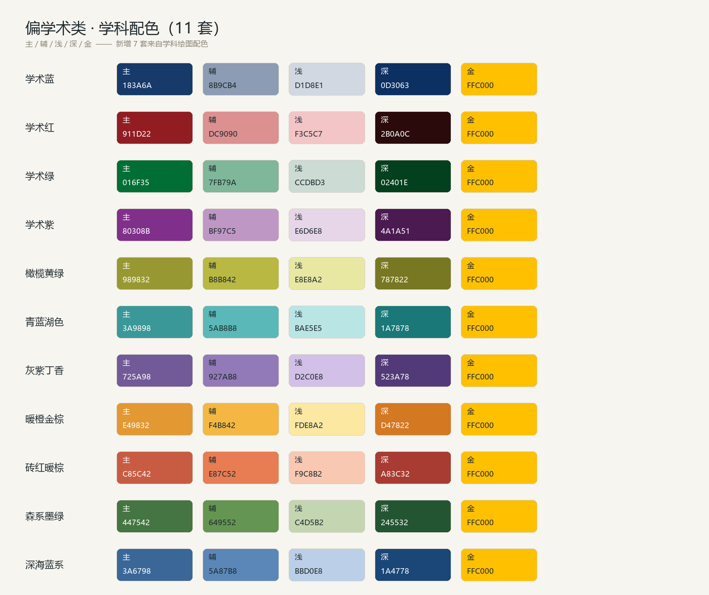

# palette-tools · 学科配色

> 偏学术类（学术模式）的配色库。**调用前必须先问选色**：先给 4 套主推，再列 7 套学科配色。



## 一、11 套配色

| key | 名称 | 主色 | 辅色 | 浅色 | 深色 | 适用 |
|---|---|---|---|---|---|---|
| `academic-blue` | 学术蓝 | `183A6A` | `8B9CB4` | `D1D8E1` | `0D3063` | 最常用，答辩/申报书首选 |
| `academic-red` | 学术红 | `911D22` | `DC9090` | `F3C5C7` | `2B0A0C` | 强调结论、成果展示 |
| `academic-green` | 学术绿 | `016F35` | `7FB79A` | `CCDBD3` | `02401E` | 生态/环境/田野调研 |
| `academic-purple` | 学术紫 | `80308B` | `BF97C5` | `E6D6E8` | `4A1A51` | 人文/艺术/跨学科 |
| `academic-olive` | 橄榄黄绿 | `989832` | `B8B842` | `E8E8A2` | `787822` | 农学 / 植物 / 食品类绘图 |
| `academic-lake` | 青蓝湖色 | `3A9898` | `5AB8B8` | `BAE5E5` | `1A7878` | 水文 / 气象 / GIS / 海洋科学 |
| `academic-lilac` | 灰紫丁香 | `725A98` | `927AB8` | `D2C0E8` | `523A78` | 化学 / 材料 / 纳米类绘图 |
| `academic-amber` | 暖橙金棕 | `E49832` | `F4B842` | `FDE8A2` | `D47822` | 社科 / 经济 / 管理类 PPT |
| `academic-brick` | 砖红暖棕 | `C85C42` | `E87C52` | `F9C8B2` | `A83C32` | 医学 / 生物 / 临床类绘图 |
| `academic-forest` | 森系墨绿 | `447542` | `649552` | `C4D5B2` | `245532` | 农林 / 生态 / 环境类 PPT 与 SCI 绘图 |
| `academic-ocean` | 深海蓝系 | `3A6798` | `5A87B8` | `BBD0E8` | `1A4778` | 理工科通用 PPT / SCI 绘图 |

通用辅色：金 `FFC000` / 深金 `C3AE53` / 藏青 `002060` / 灰字 `8A8578`

## 二、调用

```python
import sys; sys.path.insert(0, r'D:/DSH效果库/ppt-effects/palette-tools/tools')
from palette import get, apply_theme, tint, shade

p = get("橄榄黄绿")            # 支持中文别名
theme = apply_theme("academic-ocean")
tint(p["primary"], 0.2); shade(p["primary"], 0.2)
```

## 三、调用前置（硬规则）

**学术模式必须先问选色**，四选一或七选一，未答复不得出稿。

## 四、换色工具

| 工具 | 用途 |
|---|---|
| `tools/recolor.py` | 模板换色（定点映射，按配色名出整份） |
| `text-tools/tools/recolor_smart.py` | 样式集换色（按色相，保留浅色撞色） |

## 五、维护

- 新增配色：改 `palettes.json` + 本 README 表格 + 重新生成 `preview/配色预览.png`
