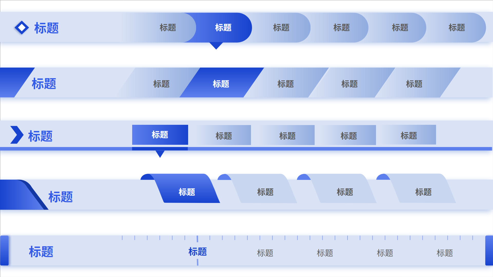

# 导航栏（navigation）

> text-tools 三分类之一：**导航栏**。占位文字统一用「标题」（导航项本身是标题层级）。

| 文件 | 说明 |
|---|---|
| `reference/导航栏-样式集.pptx` | 40 种导航栏样式（来自《PPT设计排版》第 8–15 页），共 8 页 |
| `reference/导航-分页-40.pptx` | **分页版**：40 页，每页一个样式，编号 导航001–导航040 |
| `preview-split/导航001.jpg …` | 分页版每个样式的独立预览 |
| `styles.json` | 编号 ↔ 原页 / 位置 |

分页版用法：直接复制对应编号的那一页。编号按原 8 页顺序，每页 5 个；第 1–3 页为横排导航，第 4–8 页为竖排导航。

规则：
- 导航文字 → 「标题」
- **数字序号保留**
- 形状原生可编辑；少量装饰图保留原样

调用提示：填充时需按位置顺序对应章节名，注意模板里可能有被装饰遮挡的隐藏项（见 `template-tools/调用实测-20261115.md` 第 6 条）。

## 装饰小字处理（2026-11-15，三类统一）

部分样式在"主文字"之外还有一层装饰性小字（常见于数字圆标、角标、竖排小标签）。
统一按 A 方案处理：**保留「标题/文本」占位，但把宽度 < 90px 的窄框字号压到 8pt**，
既不遮挡数字序号，也不删除任何对象、不破坏结构。

> 更宽的装饰字（>90px）仍保持原字号——这类通常是样式本身的第二层标题，属正常设计。

## 可编辑性 & 换色检查（2026-11-15）

| 项 | 结果 |
|---|---|
| 图片数 | 全部为 **0**（原小图标已转成可编辑圆角矩形） |
| 图片填充形状 | 0 |
| 形状/组合 | 标题 655/84、导航 621/31、文框 658/44 |
| 颜色 | 全部 srgbClr 实色（无图片填充、无主题锁定） |

**换色方法**

`ash
python text-tools/tools/recolor_styles.py 样式集.pptx 学术蓝 输出.pptx
`

实测：标题样式集换学术蓝，改色 434 处，红→蓝整体生效。
（红系映射 C00000/920000/FEF5F6/FCE9EB；蓝系映射 1843CE/133CA3/5D7FED/829CF1）

**自检**

`ash
python text-tools/tools/audit_editable.py 样式集.pptx
`

输出每份的图片数、图片填充数、文本条数、主色统计——图片数应为 0。

## 浅色残留：保留为撞色（2026-11-15 定案，方案 B）

智能换色后，原稿的浅粉/浅色描边会残留成"浅蓝偏白 + 一点原色"的淡彩。
**按用户意见保留**——这类撞色在版面上起到点缀作用，不做进一步压平。

- 需要完全统一时：用 `recolor_styles.py`（定点映射，压平所有浅色）
- 想保留撞色层次：用 `recolor_smart.py`（按色相换主色，浅色保留明度关系）
